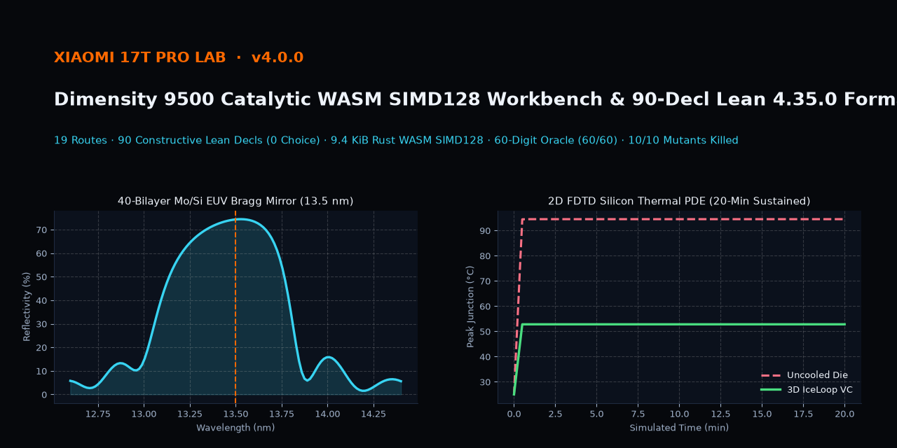

# Xiaomi 17T Pro Lab (v3.1.0)

[](https://github.com/0thernes/xiaomi-17t-pro-lab/actions/workflows/ci.yml)
[](CHANGELOG.md)
[](lean/VerifyAxioms.lean)
[](reference/physics_oracle.py)
[](LICENSE)
[](ROADMAP.md)
[](https://0thernes.github.io/xiaomi-17t-pro-lab/)

Interactive silicon-to-quantum hardware workbench, independent 60-digit differential physics oracle, a constructive Lean 4.35.0 invariant suite for the workbench's mathematical models, and an AMS-LaTeX white paper for the **Xiaomi 17T Pro** (`2602EPTC0G`, codename `warhol`) and **MediaTek Dimensity 9500** (`MT6993Z`, TSMC N3P, `140.57 mm²`).

The Lean suite proves integer invariants of the formulas the workbench uses and checks arithmetic on cited constants. It does not formally verify the device, the browser simulators, or their floating-point arithmetic, and it retires no open problem.



- **Live Interactive Workbench:** <https://0thernes.github.io/xiaomi-17t-pro-lab/>
- **Interactive Lean 4.35.0 Proof Blueprint:** <https://0thernes.github.io/xiaomi-17t-pro-lab/blueprint/>
- **Frozen AMS-LaTeX White Paper (Preprint, CC-BY-4.0):** [Donahue_2026_Xiaomi_17T_Pro_Lab.pdf](dist/Donahue_2026_Xiaomi_17T_Pro_Lab.pdf)
- **Permanent Software Heritage Snapshot:** [`swh:1:snp:06ad26ff598cf7d592768bdef08d9de7616cd4e0`](https://archive.softwareheritage.org/swh:1:snp:06ad26ff598cf7d592768bdef08d9de7616cd4e0/) (rev `swh:1:rev:1d8a87126258fa7691715ed753ee7a4f0609cc28`, full visit `2026-11-26T10:54:12Z`)
- **Author:** Alexander Stephen Donahue ([ORCID 0009-0006-8168-9648](https://orcid.org/0009-0006-8168-9648)), Independent Researcher, Spokane, WA, USA (`0_0@0thernes.art`)
- **Status:** active

---

## Quickstart

Node.js `>= 22` is required (zero build step for the web app; optional Python `>= 3.12`, Lean `4.35.0`, and Tectonic for full formal & manuscript reproduction).

```bash
git clone https://github.com/0thernes/xiaomi-17t-pro-lab.git
cd xiaomi-17t-pro-lab
npm ci
npm start            # Launches loopback server at http://127.0.0.1:47321/ (with strict CSP & COOP/COEP)
```

Verify the full suite from a clean clone:

```bash
npm run verify:all                                   # Specs schema + 50 Node tests + 8/8 mutants + 3 examples
python reference/physics_oracle.py --check-checksums # 54 differential checks at 60-digit precision + SHA-256 manifests
npm run evals                                        # 9-shard TinyStories-8M WebCrypto/Node SHA-256 + greedy regression
npm run test:smoke                                   # Playwright 19-route phone & desktop E2E smoke
```

## Lean 4.35.0 Kernel Check

```bash
cd lean
lake build XiaomiLabProofs Challenge Solution
lake env lean VerifyAxioms.lean
lake env leanchecker --fresh XiaomiLabProofs
lake env leanchecker --fresh Solution
# On Linux with bubblewrap (run in CI: 6 kernel checks of the 10 comparator targets):
lake comparator --config comparator.json --paranoid
```

All **75 audited declarations** (65 exported theorems across 7 modules + 10 isolated comparator targets) compile with zero Mathlib, zero `sorry` (outside statement-only `Challenge.lean`), zero `native_decide`, and **zero `Classical.choice`**. By `#print axioms`, 28 use no axioms, 14 use `[propext]`, and 33 use `[propext, Quot.sound]`. All declarations are kernel-checked by Lean (`lake build`, `leanchecker`). In CI the 10 comparator targets and their dependency closure were also accepted by 6 kernel checks (Lean default and paranoid mode, lean4lean, nanoda, con-leche, con-ron); Lean default and paranoid are one implementation, so these are 5 distinct kernels. CI also runs live negative kernel and comparator rejection (`scripts/test_negative_lean.py`). See [docs/statement-fidelity.md](docs/statement-fidelity.md), [docs/literature-search-log.md](docs/literature-search-log.md), and [formalization.yaml](formalization.yaml).

### What the Lean suite proves

The universally quantified results, over `Int`, `Nat` and `ℤ[i]`, are:

- roofline `min(peak, ai·bw)` is at most each term, and is monotone in `bw` for `ai ≥ 0`;
- `k·λ·NA`, and for `NA > 0` also `k·λ·NA²`, strictly increase in `NA` when `k, λ > 0`; reading this as Rayleigh `CD = k1·λ/NA` falling and `DOF = k2·λ/NA²` shrinking is informal, since division is not formalized;
- a scalar Crank–Nicolson (Cayley) step with integer `h` preserves the norm; this is one scalar factor, not the full operator;
- `−E < p < E` when `E ≥ 0`, `m > 0` and `E² = p² + m²`;
- the 5-point heat stencil satisfies the min/max principle when `rx, ry ≥ 0` and `2rx + 2ry ≤ D`;
- CHSH and Mermin-3 lie in `[−2, 2]` for ±1 inputs; any integer 3×3 Peres–Mermin assignment satisfies at most 5 of 6 contexts;
- the single-qubit Bloch identity and purity bounds, in cleared-denominator form;
- 2×2 determinants multiply; 2- and 4-point DFT Parseval.

Many of the other declarations are literal arithmetic on cited constants (die area, unit counts, clock ordering, the photon-energy ratio, shard byte sizes) closed by `decide`. They check the arithmetic, not the cited values. All results are textbook mathematics in small finite or integer settings: the CHSH inequality (Clauser, Horne, Shimony and Holt, 1969), the Mermin GHZ bound (Mermin, 1990), the Peres–Mermin square (Peres, 1990), the Crank–Nicolson scheme (Crank and Nicolson, 1947), and the roofline model (Williams, Waterman and Patterson, 2009). None is new mathematics.

### Verbatim Headline Comparator `#print axioms` Output (CI Drift-Checked)

<!-- LEAN_AXIOMS_START -->

```text
'XiaomiLab.ComparatorTarget.target_thm1_hardware_and_roofline' depends on axioms: [propext, Quot.sound]
'XiaomiLab.ComparatorTarget.target_thm2_euv_rayleigh_and_dof' depends on axioms: [propext, Quot.sound]
'XiaomiLab.ComparatorTarget.target_thm3_dirac_finfet_and_crank_nicolson' depends on axioms: [propext, Quot.sound]
'XiaomiLab.ComparatorTarget.target_thm4_fdtd_cfl_maximum_principle' depends on axioms: [propext, Quot.sound]
'XiaomiLab.ComparatorTarget.target_thm5_chsh_and_mermin3_classical_caps' does not depend on any axioms
'XiaomiLab.ComparatorTarget.target_thm6_peres_mermin_magic_square' depends on axioms: [propext, Quot.sound]
'XiaomiLab.ComparatorTarget.target_thm7_bloch_purity_bounds' depends on axioms: [propext, Quot.sound]
'XiaomiLab.ComparatorTarget.target_thm8_adversarial_refutations' does not depend on any axioms
'XiaomiLab.ComparatorTarget.target_thm9_bragg_parseval_and_shards' depends on axioms: [propext, Quot.sound]
'XiaomiLab.ComparatorTarget.target_nonvacuity_witnesses' does not depend on any axioms
```

<!-- LEAN_AXIOMS_END -->

## Usage

### Interactive Browser Labs (`10⁻¹ m → 10⁻¹⁵ m`)

Press **`Ctrl+K`** anywhere to jump to any lab, physics solver, live workload, or FCC component. Hover any 3D part to inspect provenance-badged specs; click to focus (`R` resets framing).

| Route                           | Scale          | Live Real-Time Computation                                                                                                                                                                                 |
| :------------------------------ | :------------- | :--------------------------------------------------------------------------------------------------------------------------------------------------------------------------------------------------------- |
| **Phone** (`#/`)                | `10⁻¹ m`       | Interactive 3D Xiaomi 17T Pro with PBR microfacet maps, HyperOS 3 telemetry OLED, Leica triple optics, 7-layer FCC teardown, raycast inspector                                                             |
| **Zoom** (`#/zoom`)             | `10⁻¹→10⁻¹⁵ m` | 8-rung Powers-of-Ten descent: Phone → PCB → MT6993Z PoP → `140.57 mm²` Die → C1-Ultra → FinFET → Si Crystal → Quantum Tunnel / Dirac                                                                       |
| **CPU** (`#/cpu`)               | `28.75 mm²`    | 15-level taxonomy, live Sattolo pointer-chase latency curve, WASM SIMD `f32x4`, COOP/COEP timer isolation, ARMv9.3-A decoder                                                                               |
| **GPU** (`#/gpu`)               | `24.23 mm²`    | 16-level Mali-G1 Ultra MC12 + RTUv2 stack, checked WebGPU/WebGL2 matmul vs Float64 reference, interactive TBDR tile-binner                                                                                 |
| **NPU 990** (`#/npu`)           | `12.60 mm²`    | 14-level 4× MDLA + 2× MVPU + CIM stack, live FP64 vs INT8 vs BitNet 1.58-bit error heatmaps (labeled CPU JS/WASM, not NPU dispatch)                                                                        |
| **RAM & UFS** (`#/memory`)      | `76.8 GB/s`    | MT6993Z + SK hynix `H58GG6AV9H` PoP, live STREAM Triad + 16 MB copy, CS Roofline plot, LLM memory-wall & UFS 4.1 load calculator                                                                           |
| **Thermal PDE** (`#/thermal`)   | `5,500 mm²`    | Live 2D explicit FDTD heat PDE with CFL sub-stepping & smooth closed-loop DVFS (`<= 0.5 s`), FLIR Ironbow shader, 20-minute exact clock (`1,200 s`)                                                        |
| **EUV Litho** (`#/litho`)       | `13.5 nm`      | 2D Fourier partial-coherence EUV simulator (`6T SRAM`, `L-Bend`, `Via0`, `48 nm Lines`) + OPC serifs, 40-pair Mo/Si Bragg transfer matrix (`74.32%`), sub-pixel Poisson shot-noise LER                     |
| **Atom & QED** (`#/transistor`) | `10⁻⁸→10⁻¹⁵ m` | Unitary Crank–Nicolson TDSE (`norm err < 1e-8`), N3P FinFET double-gate $\lambda$, Kronig–Penney bands, Varshni $n_i(T)$, Dirac dispersion                                                                 |
| **Workloads** (`#/work/*`)      | `Live Run`     | 6K PBR stress arena, deterministic 9-shard TinyStories-8M GPT-Neo with exact full-vocab Shannon entropy & Neuralese hooks, 272-neuron Glitchling A-Life, Bloch/CHSH/Mermin-3/Peres–Mermin quantum composer |
| **Versus** (`#/compare`)        | `3-Way`        | Normalized multi-metric scoreboard vs iPhone 18 Pro Max & Galaxy S26 Ultra with strict same-lab attribution                                                                                                |
| **Specs** (`#/specs`)           | `FCC + Die`    | Searchable forensic catalog of 29 FCC/kernel parts, 22 source conflicts with precedence rules, 12 issues, and 7 explicit `UNKNOWN` leaves                                                                  |

### Programmatic Examples (`examples/`)

```bash
node examples/01_euv_and_bragg.mjs
node examples/02_thermal_fdtd_iceloop.mjs
node examples/03_quantum_contextuality.mjs
```

### One-Word Task Runner (`justfile`)

```bash
just reproduce   # Full verification ladder: tests, mutants, examples, 60-digit oracle, evals, bench, stats, Lean 4, LaTeX PDF
just audit       # Build Standard v1.2.0 90-item repository audit
```

## Verification & Research Artifacts

- **Claims & Falsifiers:** [CLAIMS.md](CLAIMS.md) (`C01`–`C12`) · [VERIFICATION.md](VERIFICATION.md) · [REPLICATION.md](REPLICATION.md)
- **Hardening & Reviews:** [HARDENING_LOG.md](HARDENING_LOG.md) · [docs/reviews/2026-11-26-round2-3-cycle-hardening-audit.md](docs/reviews/2026-11-26-round2-3-cycle-hardening-audit.md) · [docs/reviews/2026-11-25-3-cycle-hardening-audit.md](docs/reviews/2026-11-25-3-cycle-hardening-audit.md) · [ERRATA.md](ERRATA.md)
- **Mega-Atlas & Literature:** [docs/mega-atlas-cross-reference.md](docs/mega-atlas-cross-reference.md) (**0 / 1,900** grand open problems retired) · [docs/literature-search-log.md](docs/literature-search-log.md) · [results/citation-audit.json](results/citation-audit.json) (12/12 DOIs non-retracted)
- **Formal & Security Docs:** [docs/statement-fidelity.md](docs/statement-fidelity.md) · [docs/threat-model.md](docs/threat-model.md) · [docs/ai.md](docs/ai.md) · [docs/benchmarks.md](docs/benchmarks.md) · [docs/preregistration.md](docs/preregistration.md)

## Limitations

- **Zero Mega-Atlas Retirements:** This repository solves **0 / 1,900** open problems in `0thernes/unsolved-problems-mega-atlas`.
- **No Browser NPU 990 Dispatch:** All live LLM and quantization workloads run on the visitor's JavaScript CPU thread (or WebGL2), never on MediaTek NPU 990.
- **Unpublished Hardware Leaves Stay `UNKNOWN`:** Nominal battery watt-hours, reverse-wireless wattage, rear glass composition, device UFS lanes, GPU clock, and proprietary TSMC N3P process-kit ground rules remain explicitly `null` / `UNKNOWN`.
- **Not Externally Peer Reviewed:** The AMS-LaTeX white paper is an independent research preprint. See [LIMITATIONS.md](LIMITATIONS.md) for the full literal-vs-metaphor boundary table.

## License

- First-party source code: **MIT License** ([LICENSE](LICENSE))
- AMS-LaTeX white paper (`paper/`, `dist/`), figures, and documentation: **CC-BY-4.0** ([NOTICE](NOTICE))
- Third-party bundled libraries, fonts, CC0 assets, TinyStories-8M weights, and Glitchling port retain their upstream licenses ([THIRD_PARTY_NOTICES.md](THIRD_PARTY_NOTICES.md), [CREDITS.md](CREDITS.md)).
