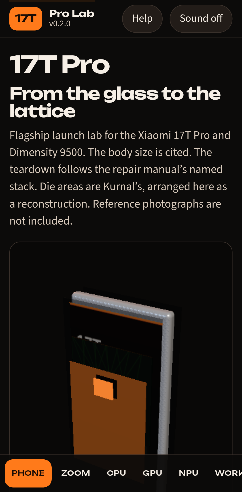
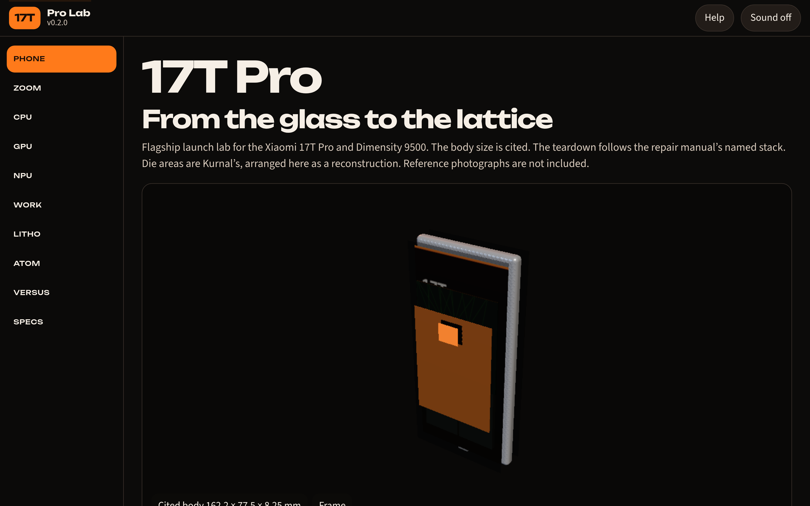
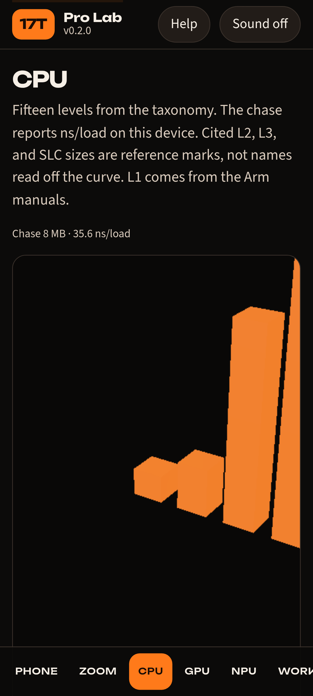
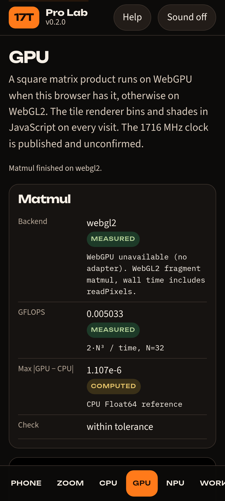
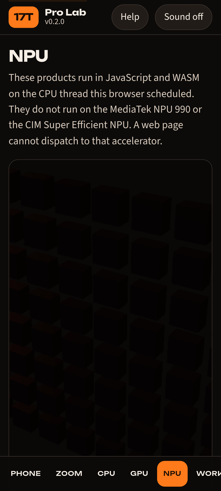
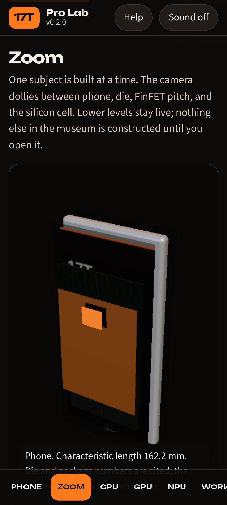
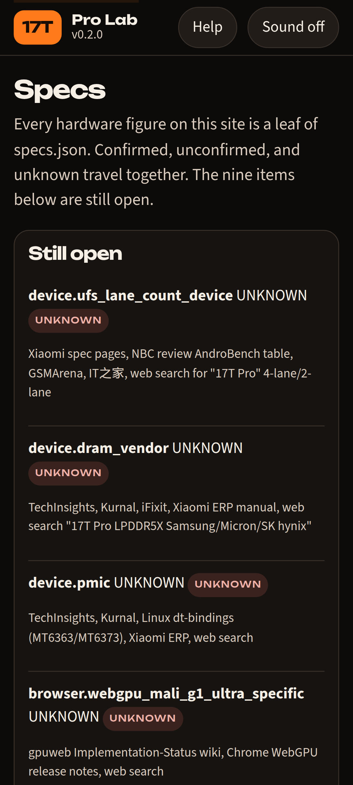

# Xiaomi 17T Pro Lab

[](https://github.com/0thernes/xiaomi-17t-pro-lab/actions/workflows/ci.yml)
[](CHANGELOG.md)
[](LICENSE)
[](https://0thernes.github.io/xiaomi-17t-pro-lab/)

Phone-first lab for the **Xiaomi 17T Pro** and the **MediaTek Dimensity 9500** (TSMC **N3P FinFET**, not GAA). v0.2 rebuilds the shell and the models around the same solvers. Every hardware number is a leaf in `data/specs.json`: **CITED**, **UNCONFIRMED**, or **UNKNOWN**. Live numbers are **MEASURED** or **COMPUTED**.

Live demo: <https://0thernes.github.io/xiaomi-17t-pro-lab/>

Owner: Alex Donahue (GitHub [0thernes](https://github.com/0thernes)).

## What you can do

| Route  | What is live                                                                                           |
| ------ | ------------------------------------------------------------------------------------------------------ |
| Phone  | Exploded body at the cited size. Internals follow the repair manual and are a reconstruction           |
| Zoom   | Phone, die, FinFET pitch, lattice. One subject at a time                                               |
| CPU    | Pointer-chase ns/load, Arm L1 leaves, a five-stage pipeline, 15 taxonomy levels                        |
| GPU    | WebGPU or WebGL2 matmul checked against the CPU, plus a JS tile rasterizer. 1716 MHz stays unconfirmed |
| NPU    | INT8 matmul in JS. 100 TOPS stays unconfirmed. The page says it is not the NPU 990                     |
| Work   | Instanced stress scene, TinyStories-8M, Glitchling, RK4 / Dormand–Prince, a local browser shell        |
| Litho  | Rayleigh CD and a live 1D Abbe aerial image                                                            |
| Atom   | Finite-difference well, Kronig–Penney, double-gate scale length                                        |
| Versus | PhoneArena table, plus iPhone Geekbench 6.7 marked as Notebookcheck                                    |
| Specs  | Open leaves, conflicts 16–22, and the parts, versions, issues, and supply-chain catalogs               |

## Screenshots

Phone viewport (Pixel 7). The hero below is the low tier this environment measured (software WebGL). A faster GPU selects medium, high, or ultra and turns on the studio environment and bloom.















## Run locally

Node 22 or newer. No build step. Dependencies in `package.json` are for tests and formatting only.

```bash
npm install
npm start
```

Open <http://127.0.0.1:47321/>. The dev server sends COOP/COEP so `crossOriginIsolated` is true, and it also accepts the GitHub Pages prefix `/xiaomi-17t-pro-lab/`.

The page is ES modules with relative URLs, so it loads from a subpath. `file://` will not load modules in Chrome.

Sound is off until you press **Sound on**. The score is synthesized in WebAudio.

## Tests

```bash
npm test          # node:test + specs.json validation
npm run lint      # prettier
npm run test:smoke  # Playwright, Pixel 7, every route, plus a forced WebGL2 matmul
```

Physics checks include Rayleigh’s k₁ = 0.25 limits (10.23 nm at NA 0.33, 6.14 nm at NA 0.55), an FFT round trip, aerial-image contrast on either side of the coherent cutoff, infinite-well eigenvalues against n²π²ℏ²/(2mL²), a Kronig–Penney gap, and the double-gate scale length.

## Provenance

See [docs/DATA-PROVENANCE.md](docs/DATA-PROVENANCE.md) and [docs/MEASUREMENTS.md](docs/MEASUREMENTS.md). The machine-readable sources are [data/specs.json](data/specs.json) and [data/taxonomy.json](data/taxonomy.json). Narrative dossiers live in [docs/research/](docs/research/).

## Docs

[docs/INDEX.md](docs/INDEX.md)

## License

MIT for the lab’s code. three.js is MIT. p5.js is LGPL-2.1 and is vendored unmodified. Fonts are OFL. See [THIRD-PARTY-NOTICES.md](THIRD-PARTY-NOTICES.md).
