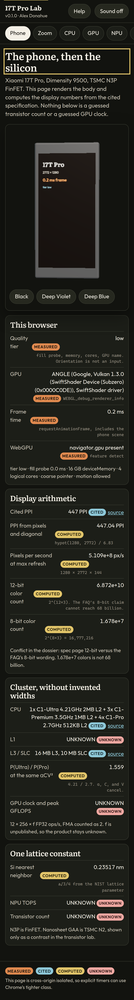
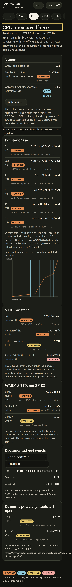
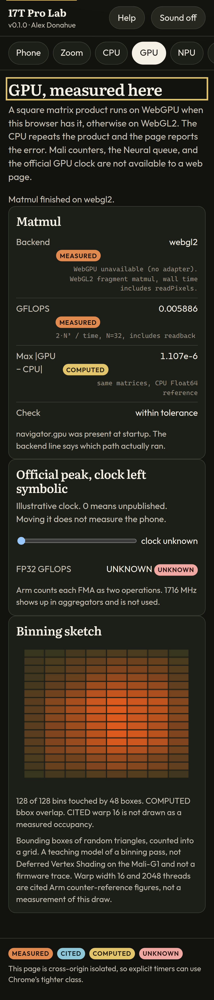
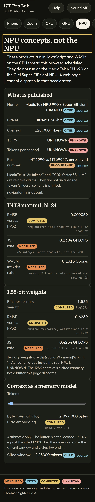
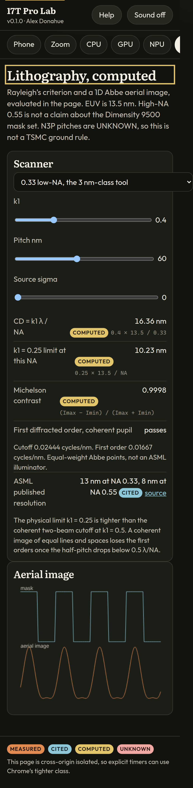
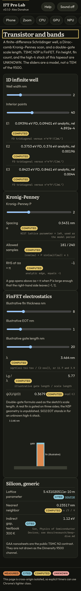
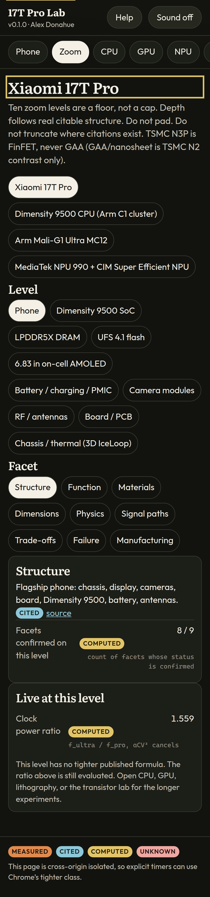

# Xiaomi 17T Pro Lab

[](https://github.com/0thernes/xiaomi-17t-pro-lab/actions/workflows/ci.yml)
[](CHANGELOG.md)
[](LICENSE)
[](https://0thernes.github.io/xiaomi-17t-pro-lab/)

Phone-first lab for the **Xiaomi 17T Pro** and the **MediaTek Dimensity 9500** (TSMC **N3P FinFET**, not GAA). Every view computes something in the browser. Every hardware number is **MEASURED** on this device, **CITED** from a source, or **COMPUTED** from a formula written next to it. Unpublished figures stay **UNKNOWN**.

Live demo (placeholder until Pages is enabled on the public repo): <https://0thernes.github.io/xiaomi-17t-pro-lab/>

Owner: Alex Donahue (GitHub [0thernes](https://github.com/0thernes)).

## What you can do

| Route      | What is live                                                                                                              |
| ---------- | ------------------------------------------------------------------------------------------------------------------------- |
| Phone      | three.js body at the cited 162.2 × 77.5 × 8.25 mm size, PPI and pixel-rate arithmetic, quality tier from a fill probe     |
| Zoom       | `taxonomy.json` stacks (device tree, 15 CPU levels, 16 GPU, 14 NPU) and a formula for the level you are on                |
| CPU        | Pointer-chase latency sweep, STREAM triad, WASM SIMD, documented A64 words                                                |
| GPU        | WebGPU matmul, WebGL2 fallback, checked against CPU math. Official GFLOPS stays symbolic because the GPU clock is unknown |
| NPU        | INT8 and 1.58-bit matmul in JS/WASM. Labeled as **not** the NPU 990                                                       |
| Litho      | Rayleigh CD and a 1D Abbe aerial image (EUV 13.5 nm, NA 0.33 vs 0.55)                                                     |
| Transistor | Finite-difference infinite well, Kronig–Penney scan, double-gate scale length                                             |
| Compare    | Cited wins and losses versus iPhone 18 Pro Max and Galaxy S26 Ultra, plus ratios computed from those numbers              |

## Screenshots

Phone viewport (Pixel 7). The hero below is the low tier this environment measured (software WebGL). A faster GPU selects medium, high, or ultra and turns on the studio environment and bloom.
















## Run locally

Node 22 or newer. No build step. Dependencies in `package.json` are for tests and formatting only.

```bash
npm install
npm start
```

Open <http://127.0.0.1:47321/>. The dev server sends COOP/COEP so `crossOriginIsolated` is true, and it also accepts the GitHub Pages prefix `/xiaomi-17t-pro-lab/`.

The page is ES modules with relative URLs, so it loads from a subpath. `file://` will not load modules in Chrome.

Sound is off until you press **Sound on**. The score is synthesized in WebAudio.

## Tests

```bash
npm test          # node:test + specs.json validation
npm run lint      # prettier
npm run test:smoke  # Playwright, Pixel 7, every route, plus a forced WebGL2 matmul
```

Physics checks include Rayleigh’s k₁ = 0.25 limits (10.23 nm at NA 0.33, 6.14 nm at NA 0.55), an FFT round trip, aerial-image contrast on either side of the coherent cutoff, infinite-well eigenvalues against n²π²ℏ²/(2mL²), a Kronig–Penney gap, and the double-gate scale length.

## Provenance

See [docs/DATA-PROVENANCE.md](docs/DATA-PROVENANCE.md) and [docs/MEASUREMENTS.md](docs/MEASUREMENTS.md). The machine-readable sources are [data/specs.json](data/specs.json) and [data/taxonomy.json](data/taxonomy.json). Narrative dossiers live in [docs/research/](docs/research/).

## Docs

[docs/INDEX.md](docs/INDEX.md)

## License

MIT for the lab’s code. three.js is MIT. p5.js is LGPL-2.1 and is vendored unmodified. Fonts are OFL. See [THIRD-PARTY-NOTICES.md](THIRD-PARTY-NOTICES.md).
